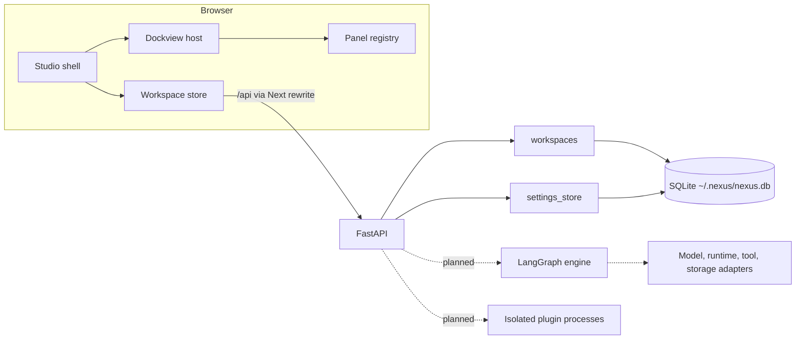

# Architecture

Sections marked *planned* describe intent and contain no code yet.

## Overview



## Repository

```
backend/    FastAPI application (src/nexus), Alembic migrations, pytest suite
frontend/   Next.js application, Vitest unit tests (src/**), Playwright tests (e2e/)
docs/       Design documents
```

## Frontend

| Module | Responsibility |
|---|---|
| `core/panels/registry.ts` | `PanelRegistry`: the only way the workspace knows a panel exists |
| `core/workspace/presets.ts` | Declarative default layouts: data, not code |
| `core/workspace/layout.ts` | Loads presets and saved layouts into Dockview; handles unknown panels |
| `core/workspace/store.ts` | Workspace state, debounced ordered autosave, created by a factory with an injected API client |
| `components/shell/` | Title bar, status bar, Dock host, group actions, panel error boundary |
| `panels/` | Panel implementations and the built-in panel list (`panels/index.ts`) |
| `lib/api.ts` | Typed API client; responses are parsed with Zod at the boundary |

Dependencies are passed through `StudioProvider`; there are no module-level singletons.

**Autosave.** Dockview emits `onDidLayoutChange`; `DockHost` compares the serialized layout with the
last known one and forwards real changes. The store coalesces them for 500 ms, writes one at a time,
flushes before switching workspace and on `pagehide`, and keeps a failed write for retry. The status
bar reports the true save state.

**Resilience.** A layout that references an unregistered panel opens with a visible stand-in; a
corrupt layout falls back to the preset with a notice; a throwing panel is contained by
`PanelBoundary`; an unreachable backend shows a retry screen.

## Backend

Modules are grouped by domain, each with `models`, `schemas`, `service`, `routes`. Routes hold no
business logic. `create_app(settings)` builds the app from explicit settings, which is how tests get
an isolated database. Sessions commit on success and roll back on error (`session_scope`).

Migrations run at startup through Alembic. SQLite uses WAL and foreign keys.

## API (Milestone 1)

| Method | Path | Purpose |
|---|---|---|
| GET | `/api/health` | Liveness and version |
| GET, POST | `/api/workspaces` | List, create |
| GET, PATCH, DELETE | `/api/workspaces/{id}` | Read, partial update, delete (last one protected) |
| POST | `/api/workspaces/{id}/duplicate` | Copy under a new identity |
| GET | `/api/workspaces/{id}/export` | Portable document |
| POST | `/api/workspaces/import` | Create from a portable document |
| GET, PUT | `/api/settings/{key}` | Application settings |

## Data model

| Table | Status | Contents |
|---|---|---|
| `workspaces` | built | id, name, description, preset, layout (Dockview JSON), panel_states, preferences, position, timestamps |
| `app_settings` | built | key, JSON value, timestamp |
| `workflows`, `workflow_versions` | *planned, M2* | Topology and immutable versions |
| `executions`, `node_executions`, `sessions` | *planned, M3* | Run records; large artifacts on disk |
| `providers`, `models`, `secrets` | *planned, M4* | Registry; secrets encrypted and never returned to the browser |
| `agents`, `agent_versions`, `runtimes` | *planned, M5* | Definitions, kept separate from models and runtimes |
| `plugins` | *planned, M6* | Installed plugin metadata |

LangGraph checkpoints get their own SQLite file, owned by `langgraph-checkpoint-sqlite`.

## Security (current)

- The API binds to `127.0.0.1` by default.
- `TrustedHostMiddleware` rejects unknown `Host` headers, which blocks DNS rebinding.
- The browser uses one origin through a Next rewrite, so CORS stays disabled.
- Request bodies are validated with `extra="forbid"`; stored documents are capped at 2 MB.
- The data directory is created with mode `0700`.

The API has no authentication: any local process can call it. This must be resolved before Milestone
3 introduces execution ([T-009](TECHNICAL_DECISIONS.md)).
