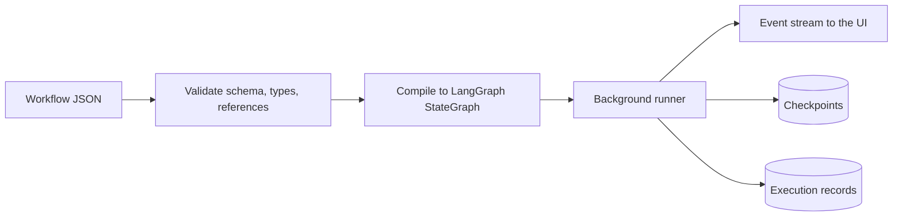
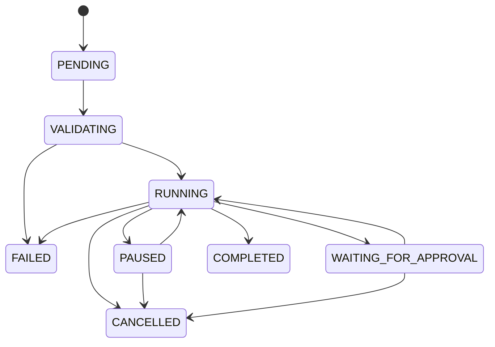

# Workflow engine

**Status: implemented for logic and data nodes.** Agent, model and tool nodes have no handlers yet.

## Principles

- The frontend edits data. It never executes workflow logic.
- The backend validates, compiles and runs; Pydantic is authoritative.
- Graph compilation never evaluates code supplied by the frontend.
- Topology is separate from node implementation.

## Workflow document

```json
{
  "format": "nexus.workflow",
  "workflow": {
    "name": "Example",
    "description": "",
    "schema_version": 1,
    "nodes": [{
      "id": "n1",
      "type": "core.llm_agent",
      "position": { "x": 0, "y": 0 },
      "label": "",
      "config": {},
      "runtime": {},
      "permissions": [],
      "input_schema": null,
      "output_schema": null,
      "parent_id": null,
      "width": null,
      "height": null
    }],
    "edges": [{
      "id": "e1",
      "source": "n1",
      "source_port": "out",
      "target": "n2",
      "target_port": "in",
      "label": ""
    }],
    "variables": {},
    "config": {},
    "policies": {},
    "metadata": {}
  }
}
```

Secrets appear as `{"secret": "<name>"}`, never as values. `schema_version` upgrades run through
`workflows/migrations.py`: pure functions applied in order when a document is imported or read. No
real migration exists yet, because the schema is still at version 1.

## Validation rules

| Severity | Codes |
|---|---|
| Error | `unknown_node_type`, `duplicate_node_id`, `duplicate_edge_id`, `duplicate_edge`, `invalid_config`, `invalid_runtime`, `unknown_permission`, `invalid_parent`, `edge_unknown_node`, `edge_unknown_port`, `edge_to_self`, `edge_port_type`, `missing_required_input`, `input_accepts_one`, `unbounded_cycle` |
| Warning | `no_input`, `no_output`, `disconnected` |

## Pipeline



## Lifecycle



## Expressions

Conditions use a small parsed language: comparisons, `and`, `or`, `not`, `in`, `contains`, literals
and dotted paths. Roots are `input`, `workflow`, `variables` and `outputs`; a bare name reads from
the node's input, as in `score > 0.8`. Data Transform fills `{{expression}}` slots in a JSON template.

## Mapping onto LangGraph

| Requirement | Intended mechanism |
|---|---|
| Sequence, branching | Edges and conditional edges |
| Parallel, merge | Fan-out with state reducers; Merge uses `defer=True` |
| Loops | Cycles through a Loop node, with its limit and a global recursion limit |
| Nested workflows | A separate graph invoked by the node, five levels deep at most |
| Human approval, pause | Interrupts; pause is checked at node entry |
| Resume, checkpoint restore | SQLite checkpointer by thread |
| Retry, timeout | Our node wrapper, so each attempt is recorded |

Each row is exercised by `backend/tests/test_execution.py`.

## Agent runtimes

Adapters declare capabilities. An operation a runtime lacks returns an explicit unsupported-capability
response and is never simulated.

Mock providers exist for development and tests only, and their output is always labeled as mocked.
