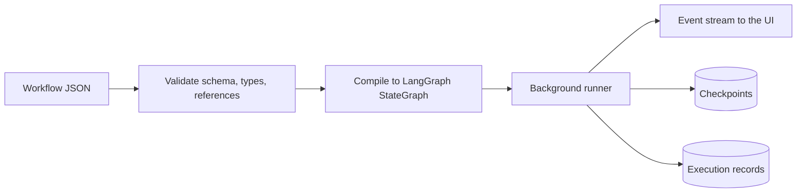
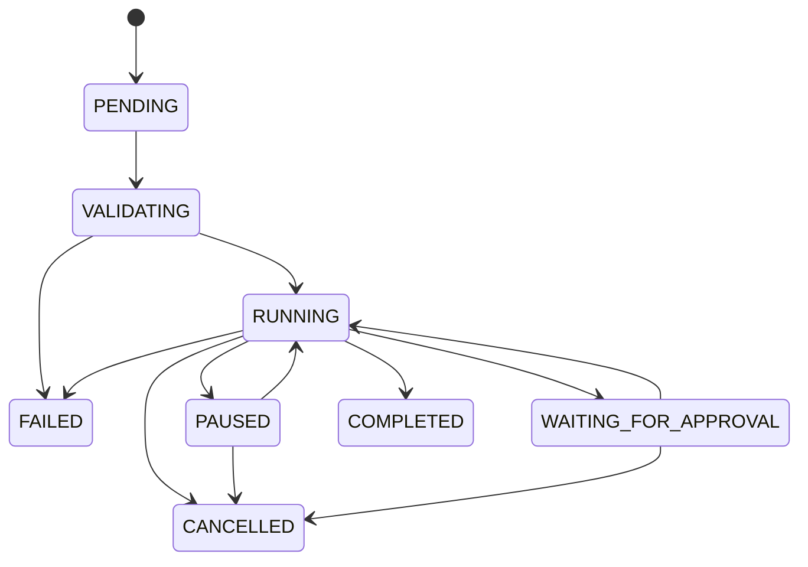

# Workflow engine

**Status: design only.** No workflow code exists yet. Milestones 2 and 3 will validate this design
against LangGraph itself and revise it.

## Principles

- The frontend edits data. It never executes workflow logic.
- The backend validates, compiles and runs; Pydantic is authoritative.
- Graph compilation never evaluates code supplied by the frontend.
- Topology is separate from node implementation.

## Workflow document (draft)

```json
{
  "id": "uuid",
  "name": "Example",
  "description": "",
  "schemaVersion": 1,
  "nodes": [{ "id": "n1", "type": "core.llm_agent", "config": {}, "position": { "x": 0, "y": 0 } }],
  "edges": [{ "id": "e1", "source": "n1", "sourcePort": "out", "target": "n2", "targetPort": "in" }],
  "variables": {},
  "config": {},
  "policies": {},
  "metadata": {}
}
```

Secrets are stored as references, never as values. Migrations between `schemaVersion` values are pure
functions, each covered by tests.

## Pipeline



## Lifecycle



## Mapping onto LangGraph

| Requirement | Intended mechanism |
|---|---|
| Sequence, branching | Edges and conditional edges |
| Parallel, merge | Fan-out with state reducers |
| Loops | Cycles with an enforced recursion limit |
| Nested workflows | Subgraphs |
| Human approval, pause | Interrupts |
| Resume, checkpoint restore | SQLite checkpointer by thread |
| Retry | Node retry policies |

Each row needs confirmation against the LangGraph documentation during Milestone 3.

## Agent runtimes

Adapters declare capabilities. An operation a runtime lacks returns an explicit unsupported-capability
response and is never simulated.

Mock providers exist for development and tests only, and their output is always labeled as mocked.
